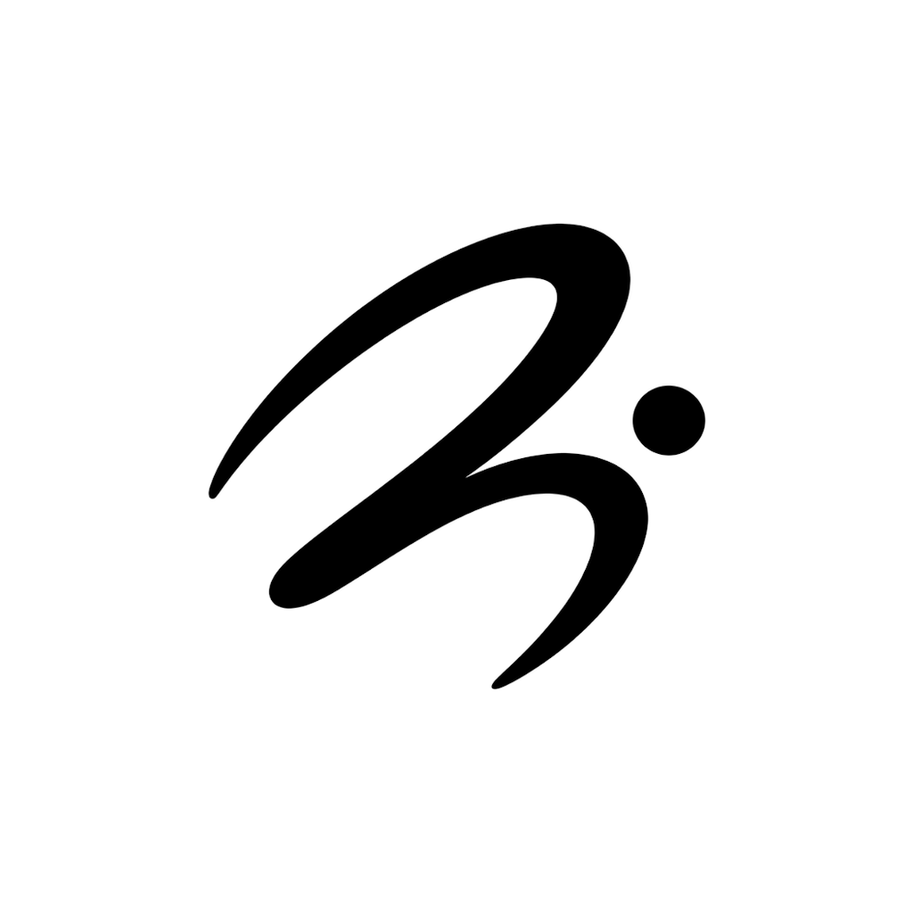

<p align="center">
  
</p>

<h1 align="center">RuN</h1>

<p align="center">
  <strong>A Privacy-First, Zero-Network App Locker & Offline Focus Suite</strong>
</p>

<p align="center">
  <a href="https://github.com/Nrajesh0/Ayva/releases/latest"></a>
  <a href="https://github.com/Nrajesh0/Ayva/releases"></a>
  <a href="LICENSE"></a>
  <a href="TRADEMARK.md"></a>
</p>

---

## Overview

**RuN** is an offline productivity and digital wellbeing application designed to protect your attention with uncompromising privacy. Featuring an app blocker, habit tracker, encrypted note vault, and floating focus tools, RuN runs entirely locally on your device with **zero network connections, zero trackers, and zero telemetry**.

## Key Highlights

- 🔒 **Zero-Network Architecture**: Operates 100% offline. No internet permission required for core functions.
- ⚡ **Direct Window Overlay Blocker**: Built for modern Android (including Android 14+ / 16+) bypassing Background Activity Launch (BAL) restrictions via direct system overlay rendering.
- 🔐 **Encrypted Vault**: High-grade encrypted notes and private archive exports.
- 🎯 **Dynamic App Themes & Avatars**: Minimalist dark and OLED modes with customizable launcher profile emblems.

## Download & Installation

You can download the latest official APK directly from GitHub Releases:

- 📦 **[Download Latest APK](https://github.com/Nrajesh0/Ayva/releases/latest)**
- 🌐 **[Official Website](https://Nrajesh0.github.io/Ayva/)**

## Building from Source

To compile the application locally using the Gradle wrapper:

```bash
./gradlew assembleRelease
```

The signed or release APK will be generated under `app/build/outputs/apk/release/`.

---

## Trademark & Brand Guidelines

The **RuN** name, logo, app icon designs, and visual branding are official brand assets. Please consult our [**Trademark Policy & Brand Guidelines**](TRADEMARK.md) for details on permitted use and rebranding requirements for forks.

## License

This project is licensed under the **GNU Affero General Public License v3.0 (GNU AGPLv3)**. See the [LICENSE](LICENSE) file for the full license terms, disclaimer of warranty, and limitation of liability.

All brand names, trademarks, logos, and app icon artwork remain proprietary under our [**Trademark Policy & Brand Guidelines**](TRADEMARK.md).
