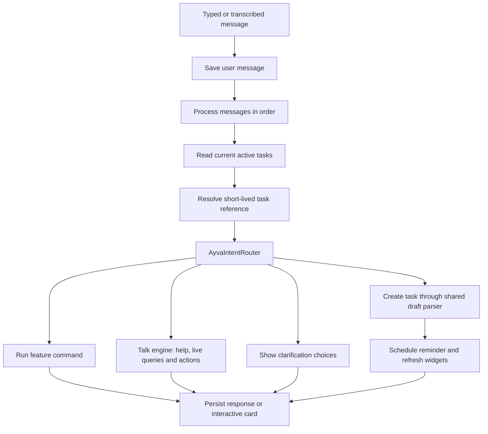

# Ayva chat: behavior review and improvement plan

> Historical first-pass review. The subsequent implementation supersedes the capability gaps and “next work” sections below. See [the offline assistant batches](AYVA_OFFLINE_ASSISTANT_BATCHES.md) for the current architecture, supported conversations, validation and limits.

Reviewed against `cb90386` (version 2.0.3), with the working-tree improvements described below. This review covers the chat activity, composer, timeline and cards, intent router, offline NLU, date parser, talk and dialogue engines, action chips, task operations, habits, learning features, voice input, and transcript storage. It combines source tracing with regression and Room-backed action tests. It does not establish physical-device behavior for overlays, speech availability, permissions, alarms, or all Compose interactions.

## What Ayva is today

Ayva is an offline, deterministic productivity assistant. It uses regular expressions, a hand-written intent classifier, fuzzy word matching, a JSON knowledge base, app database queries, and pools of response templates. The chat pipeline does not run a language model, embeddings, or general reasoning over the transcript. The knowledge base contains **41 topics**, including **18 preference-backed topics**.

This is a useful base for reliable local actions. More varied reply templates alone will not make it understand multi-step requests or remember what a user meant. Those need explicit conversation state, better ambiguity handling, and a shared execution layer.

## How a message travels

Before this change, `BubbleChatActivity.sendMessage` parsed natural messages itself, rewrote some into slash commands, and had a final catch-all task creation path. `AyvaIntentRouter` existed and had tests, but the production composer did not call it. The talk engine also had its own task creation path. Thus router tests could pass while the chat behaved differently.

The production path now is:

The lower-level talk engine still contains imperative action handlers and some duplicate intent logic. Moving those into a typed action executor is the next architectural step; this change unifies the composer routing and task draft parsing without rewriting unrelated learning or blocking systems.

## Capability inventory

| Area | What the chat currently does | Practical limits |
| --- | --- | --- |
| Message input | Typed messages, command autocomplete, quick commands, priority/persistent switches, live due-date preview | The preview is date recognition, not proof that the eventual message is a task |
| Voice input | Records/transcribes using `AudioMemoManager`, appends recognized text to the composer, requires microphone permission | On-device recognition availability depends on Android/device/language; recording alone does not submit a task |
| Task capture | Creates tasks, dates, recurring reminders, birthday/anniversary events, reminder scheduling and widget refresh | Grammar and date formats are bounded; ambiguous bare titles now offer a task/chat choice |
| Task inspection | Today/all task lists, summaries, overdue/priority information, completion history, progress cards | Some list and summary logic is still duplicated between UI and talk engine |
| Task updates | Complete, trash, reschedule, overdue triage and bulk operations; inline task-card toggles | Bulk operations need a stronger common preview/undo design; names can be ambiguous |
| Habits | Habit hub/progress cards, logging named habits, navigation to the full tracker, card-based interactions | Free-text habit matching still uses heuristics; habit creation is richer in the tracker/card than in conversation |
| Routines | Lists saved routines and enables/disables them | Enabling a routine does not mean its scheduled time window is active now |
| App restrictions | Matches installed apps/categories, adds/removes restrictions, blocks some unlocking during focus | Timed wall-clock blocking is not implemented by the chat handler; app/category matching needs more explicit disambiguation |
| Focus coaching | Live task pressure, usage, habits, time of day, breathing guidance, focus plans | A focus plan is text and navigation; it does not itself start a countdown |
| Status/diagnostics | Reads permissions, usage, battery, streaks, tasks, habits, routines and restrictions; offers settings links | Missing permissions and absent usage data must not be confused with zero usage; a valid configuration does not guarantee Android background delivery |
| Settings | Topic help, screen/system-setting links, direct preference chips, confirmation cards and some routine toggles | Writes occur through several paths with different validation and side effects; see roadmap |
| Arithmetic | Interactive drills, difficulty/length selection, blitz mode, answers, solutions, summaries, XP/gold | This is an app-owned exercise flow, not general mathematical conversation |
| Vocabulary | Learning/retention cards, practice/quiz entry points and progress interactions | Dedicated command/card flow, with limited conversational follow-ups |
| Economy/profile | Profile, quests/chest, streak freezes, wager status, reward interactions | State is app-specific; several actions open a card or screen rather than execute a conversational plan |
| Notes | Explains the privacy boundary and opens Keep Notes | Note bodies and vault content are intentionally unavailable to chat |
| Transcript | Room storage, message updates/dismissal, unread state, background alerts, active drill recovery | Storage is capped at 50 messages; most viewed messages expire after 10 minutes, with exemptions for welcomes, unread messages and active exercise cards |
| Chat presentation | Bubble/activity lifecycle, font sizing, notification colors, animated cat, action chips and specialized cards | UI appearance and lifecycle behavior still need device/Compose testing |

## Findings and changes implemented

### 1. One production router and one task draft

The composer now calls the router that its tests exercise. Natural tasks and task slash aliases use `ChatTaskDraft`, retaining recurrence, event type, date-parser notes, priority and persistence. The talk engine uses the same draft parser when it receives a task request directly.

The previous unconditional fallback could save casual text as a task. Questions, emotional statements and acknowledgements now go to chat; genuinely ambiguous bare text offers **Add as Todo Task** and **Ask Ayva**. This intentionally adds one tap for ambiguous text while leaving clear requests immediate.

### 2. Natural task requests

Supported examples include:

- `Buy milk tomorrow at 6pm`
- `Could you remind me to buy milk tomorrow at 6pm?`
- `Hey Ayva, please add a task to buy milk tomorrow at 6pm`
- `Remind me to book an appointment tomorrow`
- `Remind me to take medicine every day at 8am`

Politeness/addressing is removed before extraction. Creation prefixes must match whole words, so `Address book` and `Taskforce briefing` retain their titles. Empty titles produce a prompt instead of a placeholder task. Words such as `app`, `notes`, `appointment` or `routine` inside an explicit task no longer suppress task creation.

### 3. Bounded task follow-ups

After adding a task, `move it to tomorrow at 6pm`, `make it Friday at 4pm`, or `done` can refer to that task. After **Change Time**, a date-only reply answers that request. The reference uses a database ID, expires after ten minutes, and is rejected if the task is no longer active. Cancel and chat clearing reset it. Topic changes clear task references where recognized.

This task state is local to the current chat composition, not durable user memory. Activity recreation can lose it. Generic preference questions do not have a complete multi-turn slot-filling workflow yet.

Clarification buttons also do not yet carry a complete persisted task draft. Composer priority/persistence selections may need to be reselected after a conflict prompt. Preserving the pending draft, its attributes and the displayed candidates is part of the conversation-state work below.

### 4. Stable action targets and fewer conflict loops

Generated task buttons carry `id:<database ID>` rather than a fuzzy title or visible position. A task titled `Call mom` no longer selects **all** tasks merely because `call` contains `all`. Numeric task IDs/list positions are no longer treated as bare due times. Selecting an exact task does not keep all its weaker partial matches and re-open the same conflict prompt. Missing IDs cannot silently become new tasks.

### 5. Command meaning is preserved

Previously, `/block Instagram` reached the talk engine as `Instagram`, and `/unblock YouTube` similarly lost its verb. `AyvaChatCommands` forwards complete feature queries, preserving action, mode and arguments. Habit commands with arguments now reach the habit action handler instead of simply opening the habit hub. Task rescheduling uses the same action engine as conversational updates rather than a separate ID-versus-position implementation.

### 6. Better conversation continuity

The talk engine records one turn for every response, including greetings and other early returns. Before this change, many replies were never recorded, so old topics could remain the apparent current topic. Topic context is bounded and can be reset; clearing chat resets task and talk context. Greetings now use current local time and live pending/overdue/next-task information. Mood statements can use the existing coaching path with live app data.

Question detection now uses word boundaries; `cancel task 2` is no longer mistaken for a question just because it begins with the letters `can`.

### 7. Responses describe what actually happened

Focus replies now say they provide a plan, rather than claiming that a sprint/timer was activated. A request such as `block YouTube for 30 minutes` does not silently create an indefinite block: it explains that timed chat blocks are unsupported and links to restriction settings before making changes. Explicit bulk app/routine operations use whole-word matching for `all`.

Habit completion counts now require reaching the log's target; a partial log does not count as a completed daily habit. `read my notes` reaches the existing privacy response rather than task creation or an unrelated fallback.

### 8. Ordering and response persistence

Chat actions are serialized with a mutex and read current tasks after entering the processing queue. User message IDs use UUIDs. Interactive replies also pass through transcript persistence, including branches that previously updated only local Compose state. Coroutine cancellation is preserved in the outer message handler.

## Recommended next work, in order

### First: a shared typed action executor

Introduce an `AyvaAction` model for `CreateTask`, `RescheduleTask`, `CompleteTask`, `TrashTask`, `LogHabit`, `SetPreference`, `EnableRoutine`, and `ChangeRestriction`. Separate understanding from execution. Each action should have explicit targets, validated parameters, an execution result, and optional confirmation/undo metadata.

Route typed text, slash commands, chips, task cards and notification entry points through that executor. Today, side effects are still spread between `BubbleChatActivity`, `AyvaTalkEngine`, `TalkAction.execute`, timeline confirmation cards, and repositories. A UI callback and a typed message can still differ in validation, scheduling or reward behavior.

### Next: richer conversation state

Use a chat ViewModel with `SavedStateHandle` to retain the current topic, referenced task/habit, candidate IDs, expected reply, expiry and pending action across rotation. Ask only for a missing field: `What should I remind you about?`, `Which report?`, `When?`. Resolve `the second one` against the candidates shown in the actual previous card, rather than current database ordering. Keep confirmations tied to a specific action, never a global unqualified `yes`.

### Then: useful context and calmer replies

Create one accurate context provider for task pressure, real usage totals, habit progress, scheduled routines currently active, and focus session state. `AyvaContextEngine` is now used for greeting task/time context, but its `screenTimeMinutesToday` reads a focus-minutes map and `isStrictFocusActive` defaults to false; do not use those fields for decision-making without correcting their sources.

Prioritize the next useful step instead of repeatedly dumping the whole menu. For an overwhelmed user, offer one relevant task or an overdue triage choice. Keep action confirmations short and concrete. Add an optional tone setting if users want more or fewer emojis/motivational replies. Template variation should not obscure execution results.

### Strengthen functional correctness

- A real **Start focus** action should call the existing focus-session domain logic and report the resulting running state. It should distinguish a countdown, a usage-time budget, and a scheduled restriction.
- Routine responses should distinguish **enabled for its schedule** from **blocking now**.
- Ambiguous habit/app/routine names should offer a choice before mutation, using stable identities. Habit completion praise should use actual streak data, not a progress count.
- Preference changes should share an allowlist, type/range validation, storage owner and post-write effects. Validate signed numbers, units, enum values and clock times; avoid different implementations for direct chips and confirmation cards. The `ConversationSession` type exists, but no production path currently populates `activeSession` as a complete missing-value workflow.
- Return explicit execution failures. Several existing inner exception handlers swallow errors and fall through to general help, which can hide a partially completed operation.
- Use calendar-based day boundaries for summaries and rescheduling; fixed `86,400,000` millisecond days can be wrong around daylight-saving changes.
- Add idempotency and targeted undo for task creation/completion and bulk edits, and clear action buttons after their intended one-time execution.

### Multiple actions and optional local language understanding

`splitCompoundCommands` exists but is not wired into the send pipeline. Do not simply split every `and`: `buy bread and butter` is one task. A compound-action flow needs a preview of independently understood actions, per-action failure results and ordering. Start with explicit multi-action requests and clear limits.

If broader phrasing is still needed after routing/action correctness, evaluate an optional on-device intent model or small local language model. Let it propose the same typed actions; keep database changes, permission checks, confirmations and parameter validation deterministic. Measure APK/model size, latency, memory use, language coverage and behavior on low-end devices. Avoid promising general conversational intelligence from the current keyword engine.

## Validation

The added tests exercise both routing and real Room-backed actions: natural task phrasing, creation aliases, recurrence/flags, duplicate selection, stable IDs, reschedule/completion/trash behavior, casual text, explanations versus execution, missing titles/IDs, context expiry, greetings, habit actions/progress, notes isolation, command forwarding and truthful focus/timed-block responses.

There are **35 new chat tests** (19 routing/conversation tests and 16 Room-backed action tests). A combined full-suite/release-optimization run executed 437 tests: all new chat tests passed, but the unchanged `Batch8SecurityAuditTest.testNotesViewModelDeleteCurrentNoteHandlesPendingNewNoteId` failed its autosaved-draft trash assertion. That test passed in the preceding standalone full-suite run. The unchanged notes lifecycle has a possible interval between committing a newly autosaved row and publishing its ID to the editor; this deserves a separate notes-lifecycle investigation. The failure is recorded rather than weakening the assertion or changing unrelated notes code.

The final standalone run of `:app:testDebugUnitTest` passed **437 tests, with 0 failures, 0 errors and 0 skipped**; this includes the notes test that failed in the combined run. Physical-device checks remain necessary for the chat UI, activity recreation, speech, alarms, notifications, and restrictions. The changes do not introduce a network service or access note/vault content.

The final standalone `:app:assembleRelease --offline` build also passed. It produced `app/build/outputs/apk/release/app-release-unsigned.apk` at the existing development version 2.0.3 (code 103). These chat changes have not been committed or pushed.

## Source map

- `app/src/main/java/com/focusbyrj/app/ui/screens/BubbleChatActivity.kt`: composer orchestration, command dispatch and interactive callbacks.
- `app/src/main/java/com/focusbyrj/app/ui/screens/chat/AyvaComposerBar.kt`: input, switches, autocomplete, voice and quick commands.
- `app/src/main/java/com/focusbyrj/app/ui/screens/chat/AyvaChatTimeline.kt`: message/card rendering and preference confirmation.
- `app/src/main/java/com/focusbyrj/app/ui/components/TalkActionChips.kt`: serialized chip rendering and action execution.
- `app/src/main/java/com/focusbyrj/app/util/router/AyvaIntentRouter.kt`: production input routing and task/feature arbitration.
- `app/src/main/java/com/focusbyrj/app/util/OfflineNluEngine.kt`: intent classification and target extraction.
- `app/src/main/java/com/focusbyrj/app/util/SmartDateParser.kt`: due dates and recurrence.
- `app/src/main/java/com/focusbyrj/app/util/ChatTaskDraft.kt`: shared task construction.
- `app/src/main/java/com/focusbyrj/app/util/ChatConversationContext.kt`: short-lived task reference and date replies.
- `app/src/main/java/com/focusbyrj/app/util/command/AyvaChatCommands.kt`: slash-to-talk forwarding.
- `app/src/main/java/com/focusbyrj/app/util/AyvaTalkEngine.kt`: live queries, diagnostics, actions, FAQ retrieval and topic history.
- `app/src/main/java/com/focusbyrj/app/util/AyvaDialogueEngine.kt`: response templates and coaching text.
- `app/src/main/java/com/focusbyrj/app/util/context/AyvaContextEngine.kt`: context snapshot.
- `app/src/main/java/com/focusbyrj/app/util/command/AyvaCompoundCommandHandler.kt`: telemetry and currently unwired compound/time-limit helpers.
- `app/src/main/java/com/focusbyrj/app/util/TalkAction.kt`: navigation, settings and routine chip actions.
- `app/src/main/java/com/focusbyrj/app/util/BubbleChatManager.kt`: transcript storage, retention and unread/drill state.
- `app/src/main/assets/ayva_knowledge_base.json`: packaged knowledge and preference metadata.
